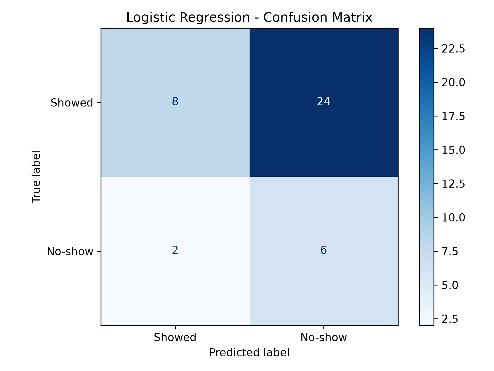

# Restaurant Reservation No-Show Prediction

## 1. Project Overview

This project develops a machine learning model to predict whether a restaurant reservation will result in a no-show.

The objective is to help Spice Route Restaurant reduce wasted table time by identifying reservations that may not be honored.

## 2. Feature Engineering

The following features were prepared:

- Day of the week
- Hour of the day
- Party size category
- Booking channel (one-hot encoded)
- Party size

### Data Leakage Prevention

The original dataset was split into training (80%) and testing (20%) sets before categorical encoding, using a random state of 42 and stratification.

One-hot encoding was fitted separately on the training data. The test data was then aligned with the training feature columns using `reindex()`, filling missing columns with zeros.

This prevents information from the test dataset from influencing feature preparation.

- Training records: 160
- Testing records: 40
- Features: 9

## 3. Model Training

- Algorithm: Logistic Regression
- Parameters: Default parameters with max_iter=1000
- Threshold candidates: 0.05 to 0.50
- Threshold selection: 5-fold Stratified Cross-Validation using training data only.

Out-of-fold probabilities were generated using cross-validation. Candidate thresholds were compared using accuracy, precision, recall, F1-score, false positives, and false negatives.

The selected threshold was 0.13 because it achieved the highest cross-validation F1-score.

### Selected Threshold Results (Training Cross-Validation)

- Threshold: 0.13
- Accuracy: 31.87%
- Precision: 20.45%
- Recall: 87.10%
- F1-score: 33.13%
- False positives: 105
- False negatives: 4

Threshold 0.15 achieved a nearly identical F1-score of 33.09%, with fewer false positives (85). However, 0.13 was selected because it achieved the highest cross-validation F1-score and prioritized no-show detection.

## 4. Model Evaluation

The final Logistic Regression model was trained using all 160 training records and evaluated on the untouched 40-record test dataset.

### Test Metrics

| Metric | Result |
|---|---:|
| Accuracy | 35.00% |
| Precision | 20.00% |
| Recall | 75.00% |
| F1 Score | 31.58% |

### Confusion Matrix

| Actual / Predicted | Showed | No-show |
|---|---:|---:|
| Showed | 8 | 24 |
| No-show | 2 | 6 |

### Confusion Matrix Interpretation

- True Negatives: 8
- False Positives: 24
- False Negatives: 2
- True Positives: 6

The model correctly identified 6 out of 8 actual no-shows.

However, it incorrectly flagged 24 reservations as potential no-shows even though those guests actually arrived.

## 5. Baseline Comparison

A DummyClassifier using the most-frequent strategy was used as the baseline model.

| Metric | Baseline | Logistic Regression |
|---|---:|---:|
| Accuracy | 80.00% | 35.00% |
| Recall | 0.00% | 75.00% |
| F1 Score | 0.00% | 31.58% |

The baseline predicts every reservation as attended. It achieves higher accuracy because most reservations in the test dataset resulted in attendance, but it fails to identify any no-shows.

Logistic Regression improves no-show detection by identifying 75% of actual no-shows, although this comes at the cost of lower accuracy and precision.

## 6. Restaurant-Specific Operational Impact

A false positive occurs when the model predicts that a guest will not show up, but the guest actually arrives.

In restaurant operations, the 24 false positives mean that 24 tables could be unnecessarily held for guests who were incorrectly flagged as potential no-shows. This can prevent the restaurant from seating other customers and reduce table utilization.

The selected threshold of 0.13 prioritizes identifying potential no-shows, but its false-positive cost is significant. Staff should therefore use predictions to prioritize reservation confirmations rather than automatically holding tables or treating flagged guests as certain no-shows.

## 7. Limitations and Future Improvements

- The dataset contains only 200 synthetic reservations.
- The model has low precision and accuracy at the selected threshold.
- More real-world reservation data is required.
- Additional features such as reservation lead time, previous no-show history, and cancellation behavior could improve predictions.
- Threshold selection should also consider the restaurant's actual operational costs of false positives and false negatives.

## 8. Conclusion

The corrected feature engineering process prevents data leakage by splitting the dataset before encoding.

Logistic Regression achieved 75% recall and a 31.58% F1-score on the test dataset, compared with 0% recall and 0% F1-score for the baseline.

Although the model identifies most actual no-shows, its 24 false positives demonstrate a significant operational trade-off.

Further improvements using real reservation data, additional features, and cost-sensitive threshold selection are necessary before practical deployment.
